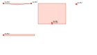

# ScoreLint

[](https://github.com/KanadeK/scorelint/actions/workflows/ci.yml)
[](https://www.python.org/)
[](LICENSE)

**Offline, explainable cut-risk preflight for stained-glass SVG patterns.**

ScoreLint reviews geometry that already exists and points a maker to measurable
features worth checking before glass is cut: intersecting contours, overlapping
pieces, sharp tips, tight concave notches, narrow sections, and very small pieces.
Every finding carries a stable code, measured value, threshold, piece ID, and location
where one exists.

It does **not** generate art, upload a design, rewrite seams, or call a piece
"impossible." Glass, grain, tools, technique, reinforcement, and assembly order still
require human judgment.



## Why this exists

Stained-glass pattern discussions repeatedly surface the same expensive failure mode:
a design looks plausible on screen but contains deep inside cuts, needle-like tips,
thin necks, or geometry that never formed a valid closed piece. Existing tools we
inspected primarily generate/edit patterns, estimate foil and solder, nest stock, or
run hosted design workflows. ScoreLint occupies a narrower slot: an independent,
local, repeatable review step for SVG files and pattern-library CI.

The [research note](docs/RESEARCH.md) records the sources, representative alternatives,
and deliberately narrow differentiation claim.

## Quick start

Install the wheel from the
[latest GitHub Release](https://github.com/KanadeK/scorelint/releases/latest):

```console
python -m pip install https://github.com/KanadeK/scorelint/releases/download/v0.1.0/scorelint-0.1.0-py3-none-any.whl
scorelint audit pattern.svg --output scorelint-report
```

For an isolated command-line installation, `pipx` accepts the same wheel URL:

```console
pipx install https://github.com/KanadeK/scorelint/releases/download/v0.1.0/scorelint-0.1.0-py3-none-any.whl
```

The command writes:

```text
scorelint-report/
├── report.json      stable schema for automation
├── findings.csv     spreadsheet-friendly findings
├── annotated.svg    portable visual overlay
└── report.html      standalone human review report
```

Example console result:

```text
0 errors, 8 warnings, 1 notices across 4 pieces
wrote 4 reports to scorelint-report
```

## Findings

| Code | Level | Measured indicator |
|---|---|---|
| `SL100` | error | Self-intersecting or zero-area contour |
| `SL101` | error | Two declared piece areas overlap |
| `SL200` | warning | Internal tip angle below `35 deg` |
| `SL201` | warning | Concave opening below `75 deg` |
| `SL202` | warning | Non-adjacent edge separation below `3 mm` |
| `SL203` | warning | Piece area below `50 mm2` |
| `SL204` | notice | Generated ID because the SVG shape has no explicit `id` |

Defaults are review prompts, not universal craft rules. Set them for your material,
tools, and process; the exact values are recorded in JSON and HTML:

```console
scorelint audit pattern.svg --output report \
  --tip-angle-deg 30 \
  --concave-opening-deg 65 \
  --min-separation-mm 2.5 \
  --min-area-mm2 35
```

See [the rule reference](docs/RULES.md) for evidence semantics and limitations.

## SVG contract

ScoreLint supports closed, filled `path`, `polygon`, `polyline`, `rect`, `circle`, and
`ellipse` elements, nested transforms, and path commands `M/L/H/V/C/S/Q/T/A/Z`.
Curves are flattened under a recorded physical tolerance. Scaling comes from physical
root dimensions plus `viewBox`, or from an explicit override for unitless documents:

```console
scorelint audit unitless.svg --output report --scale-mm-per-unit 0.264583
```

Unsupported geometry fails loudly instead of being silently omitted. DTD/entity
declarations, open paths, `<use>`, nested SVG viewports, rounded rectangles, and
multi-subpath pieces are rejected in v0.1. Maximum input is 10 MiB, 5,000 pieces, and
200,000 flattened points.

## Exit codes

- `0` — no errors or warnings; notices may exist.
- `1` — at least one error or warning; all reports are still written.
- `2` — invalid input, unsupported SVG, invalid configuration, or I/O failure; no
  successful audit is presented.

That makes pattern-library review usable in automation:

```console
scorelint audit patterns/panel.svg --output artifacts/panel
```

## Try the committed examples

```console
scorelint audit examples/clean-panel.svg --output .artifacts/clean
scorelint audit examples/risky-panel.svg --output .artifacts/risky
scorelint audit examples/curved-transformed.svg --output .artifacts/curved
scorelint audit examples/overlapping-panel.svg --output .artifacts/overlap
scorelint audit examples/malformed-open-path.svg --output .artifacts/malformed
```

The first and curved examples return `0`; risky and overlapping return `1`; the
intentionally malformed open path returns `2`.

## Privacy and trust boundary

- Runtime has no third-party dependencies, network calls, telemetry, or accounts.
- Reports contain the source basename, never its absolute path.
- Source-derived text is escaped in SVG/HTML output.
- Original artwork is read only and never modified.
- Results are geometry evidence, not cutting, structural, or safety certification.

See [SECURITY.md](SECURITY.md) for reporting vulnerabilities and the supported input
boundary.

## Development

The repository uses [uv](https://docs.astral.sh/uv/) for a locked development
environment; the published package itself remains dependency-free.

```console
uv sync --all-groups --locked
uv run python scripts/check.py
```

The full gate runs tests with branch coverage, Ruff, strict mypy, package audit,
builds wheel/sdist, installs the wheel into an isolated environment, and audits the
committed examples. Architecture and contribution details are in
[the specification](docs/SPEC.md), [ADR-001](docs/decisions/001-local-evidence-compiler.md),
and [CONTRIBUTING.md](CONTRIBUTING.md).

## License

[MIT](LICENSE)
